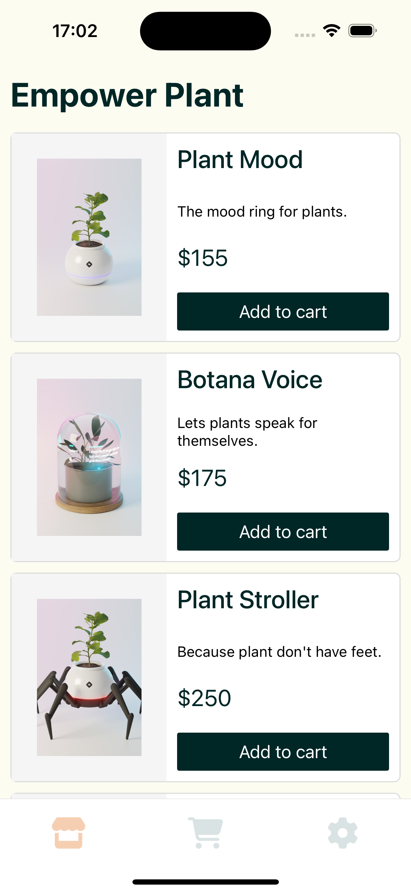
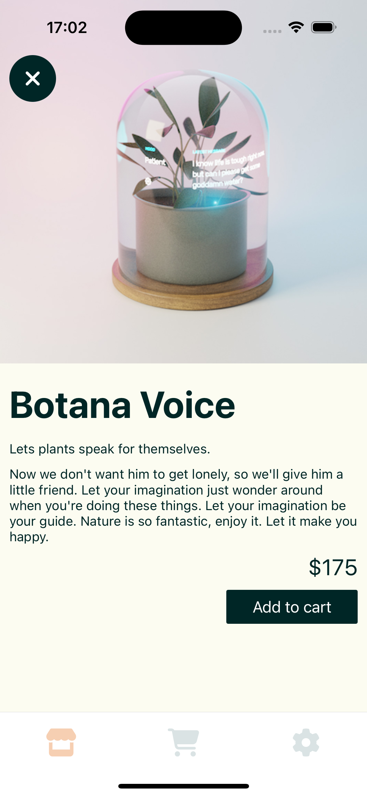
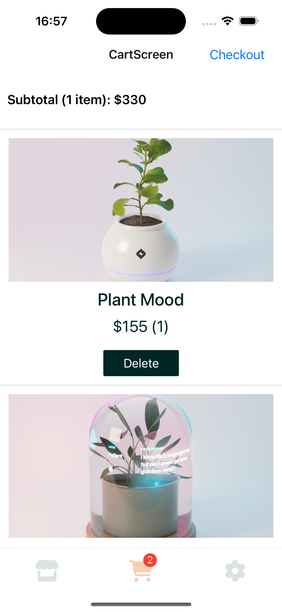

# Sentry Empower Plant React Native (Expo) Demo

This is a mock mobile app used by Solution Engineers when demo'ing Sentry's [React Native](https://docs.sentry.io/platforms/react-native) SDK's capabilities, built with [Expo](https://expo.dev).

| Home Screen | Product Detail | Cart |
|------------|----------------|------|
|  |  |  |

## Run the App in a Simulator

No build needed. Download the latest build from
[Releases](https://github.com/sentry-demos/sentry_react_native/releases):

- **Android:** download `app-release.apk` and drag it onto a running emulator.
- **iOS:** download `sentry_react_native.app.zip`, unzip it, and drag the `.app` onto a
  running simulator.

> **Note:** Release builds are built with `EXPO_PUBLIC_SE=tda`, so their events are sent to
> the `production` environment and grouped with the automated TDA data, not under your name.
> To get your own `SE` tag, follow [Setup Locally](#setup-locally) instead.

## Setup Locally

```bash
git clone https://github.com/sentry-demos/sentry_react_native.git
cd sentry_react_native
echo "EXPO_PUBLIC_SE=<your-name>" > .env.local
```

- **`EXPO_PUBLIC_SE`** — Expo reads `.env.local` automatically, and only variables prefixed
  with `EXPO_PUBLIC_` are exposed to app code. `SE` is added to event fingerprints so your
  demo issues stay separate from everyone else's. The value `tda` is reserved for release
  builds: it sets the Sentry environment to `production` and fingerprints by app version.
  Reload the app (press `r` in the Metro terminal) after changing it.
- **Optional** — `src/config.ts` ships with a working `DSN` and `BACKEND_URL`.
  Override them if you want to point at your own Sentry project or a local backend.

## Development

This app uses native modules (the Sentry config plugin), so it can't run in Expo Go.
Install dependencies, then run on Android or iOS. The `run` commands generate the native
project if needed, build and install the app, and start Metro:

```bash
npm install
npm run android # or: npm run ios
```

For release builds, the same flow CI uses (see `.github/workflows/build-*.yml`). Release
builds upload source maps, so they need a
[Sentry Auth Token](https://docs.sentry.io/account/auth-tokens/#organization-auth-tokens):

```bash
export SENTRY_AUTH_TOKEN=<token>
npx expo prebuild --platform android
cd android && ./gradlew :app:assembleRelease
```

The generated `android/` and `ios/` directories are gitignored — `expo prebuild`
recreates them from `app.config.js`, so don't edit them by hand.

## Releases

Releases are automated via `.github/workflows/release.yml` and use date-based
versioning: version name `YY.M.D` (e.g. `26.10.5`) and version code `YYMMDD` (e.g. `261005`).

- **Scheduled:** every Monday at 00:00 UTC. The workflow builds the Android APK and iOS app
  and publishes them to
  [GitHub Releases](https://github.com/sentry-demos/sentry_react_native/releases)
  as `app-release.apk` and `sentry_react_native.app.zip`. The
  [TDA pipeline](https://github.com/sentry-demos/empower/tree/master/_tda) always
  tests against the latest release, so its errors are tagged with the current version.
- **Manual:** Actions → Release → Run workflow, no inputs needed. It releases with
  today's date just like the scheduled run. If today was already released, the
  version gets a suffix (`26.10.5-1`, then `-2`, …) so it never collides with the
  automated releases.

The `version` input on the workflow is an optional escape hatch for forcing a
specific version; it fails if that version was already released.

> **Note:** Only GitHub release builds have a real version. The bump happens on a temporary
> release branch, so `package.json` on `master` stays at `1.0.0` and local builds always
> report `1.0.0`.

## Troubleshooting

See [troubleshooting.md](./troubleshooting.md) for tips.
